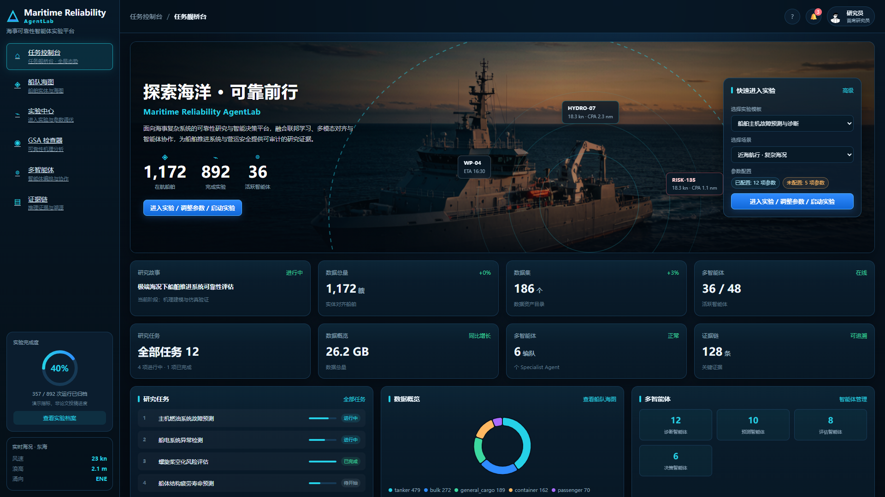
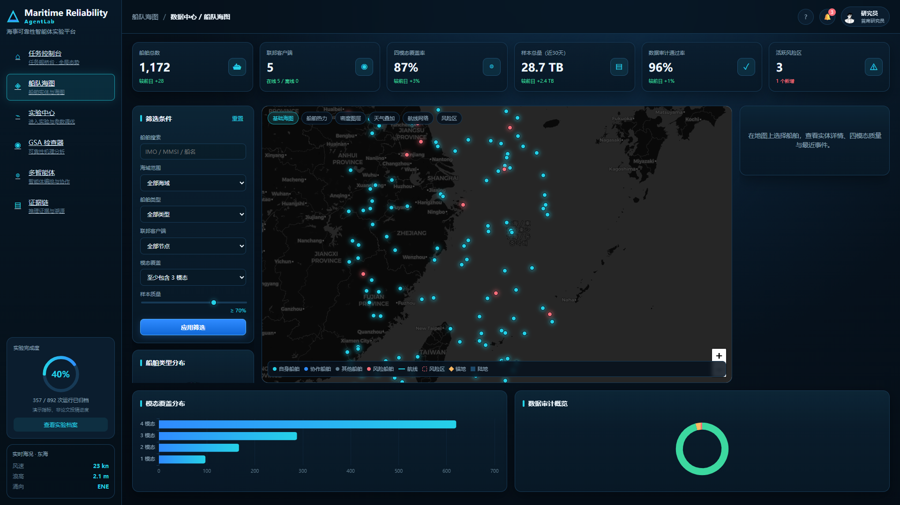
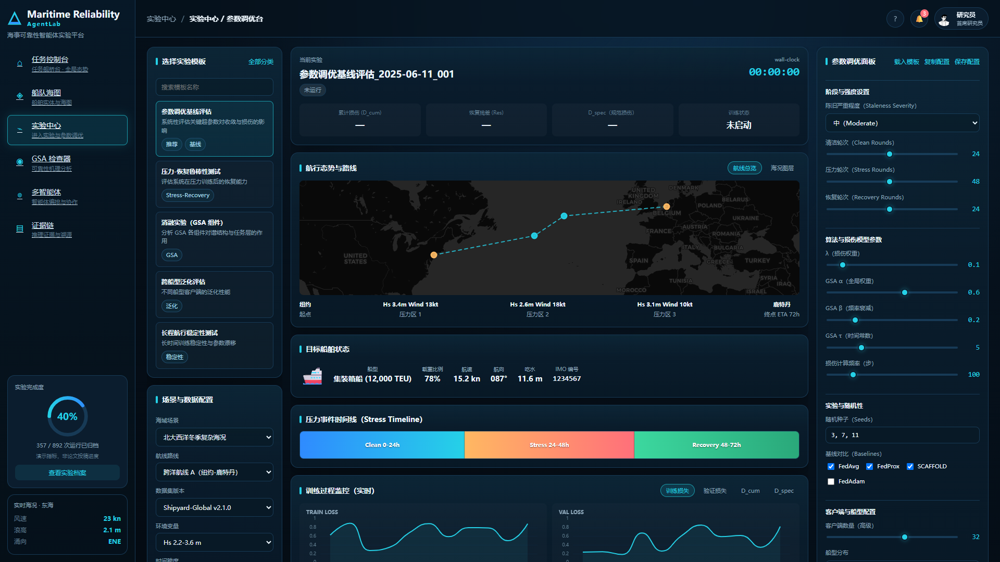
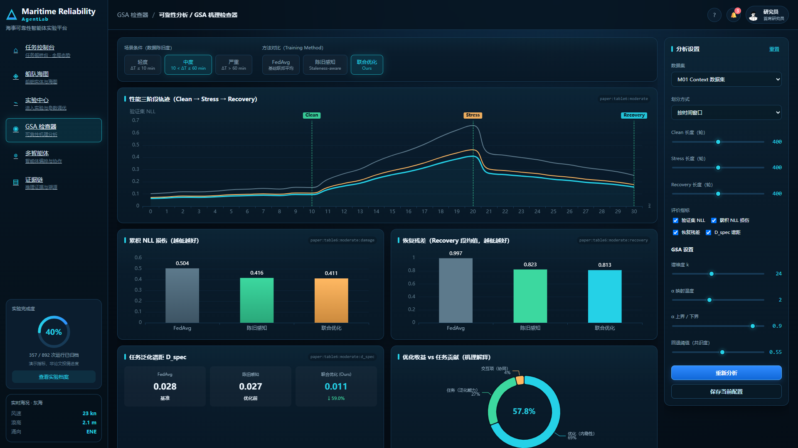
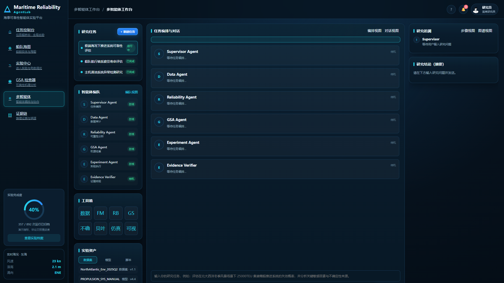
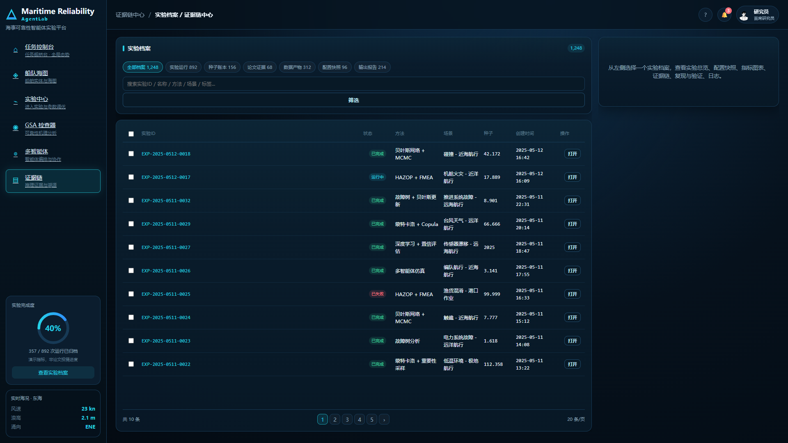

# Maritime GSA Reliability Analysis

Reproducibility code and companion-interface documentation for a Reliability Engineering & System Safety (RESS) study on reliable multimodal federated learning in maritime safety systems.

The study investigates how model-update staleness degrades reliability under dynamic maritime heterogeneity and evaluates two complementary controls: source-aware staleness weighting and Gradient-Space Alignment (GSA). This repository contains the curated analysis code used for the reported experiments. Preliminary pilots, parameter searches, intermediate merge utilities, superseded implementations, and manuscript-generation helpers are excluded.

> **Scope.** The public repository is an offline reproducibility artifact. The interface shown below is the companion *Maritime Reliability AgentLab* (MR-AgentLab v2) research prototype. Its screenshots document how datasets, protocols, mechanisms, and evidence are presented to researchers; they do not imply a live multi-institution deployment or an autonomous decision system.

## Research design

The evaluation follows a controlled 30-round stress-recovery protocol:

- rounds 1-10: clean operation;
- rounds 11-20: controlled staleness stress;
- rounds 21-30: recovery;
- principal methods: FedAvg, staleness-aware aggregation, and staleness-aware aggregation with GSA (Combined).

Evidence is organized at four levels:

| Evidence level | Representative measure | Interpretation |
|---|---|---|
| Optimization | `D_spec` | Spectral-state diagnostic targeted by GSA |
| Representation | `D_repr` | Distance or alignment in representation space |
| Task | cumulative NLL damage and recovery residual | Predictive reliability under stress and after recovery |
| System | MIA AUROC and wall-clock cost | Privacy-oriented audit and computational overhead |

## Environment

- Python 3.10 or newer (Python 3.11 recommended)
- Windows, Linux, or macOS
- CUDA is optional

```bash
python -m venv .venv
python -m pip install -r requirements.txt
```

For HRRR GRIB2 data, installing `cfgrib` and `eccodes` with Conda is usually more reliable than using pip alone.

## Repository structure

```text
maritime-gsa-reliability-analysis/
├── input/                          # AIS, HRRR, registry, and EU MRV inputs
├── experiments/
│   ├── gsa/                        # primary experiments
│   └── supplementary/              # supplementary analyses
├── docs/
│   └── images/                     # MR-AgentLab interface screenshots
├── align_shipping_data.py          # raw-data alignment
├── requirements.txt
└── README.md
```

## Reproduction workflow

Run all commands from the repository root.

### 1. Align the four data modalities

```bash
python align_shipping_data.py --data-dir input --max-ships 0
python -m experiments.gsa.prepare_dataset
```

This stage creates `aligned_samples.csv`, its quality report, and `multimodal_dataset.csv`. Preprocessing is fitted on training data only, and vessel identities remain disjoint across train and test partitions.

### 2. Run the main study

```bash
python -m experiments.gsa.run_ablation
```

The experiment includes the reported FedAvg, FedBN, and GSA ablations. Within each random seed, methods use the same split to support paired comparisons.

### 3. Run reliability, privacy, and downstream analyses

```bash
python -m experiments.gsa.robustness
python -m experiments.gsa.privacy_mia_disjoint
python -m experiments.gsa.gradient_inversion
python -m experiments.gsa.privacy_risk_analysis
python -m experiments.gsa.gradient_space_analysis
python -m experiments.gsa.communication_efficiency
python -m experiments.gsa.classification_and_link_attack
python -m experiments.gsa.downstream_emissions
```

### 4. Run the trajectory task

```bash
python -m experiments.gsa.build_trajectory_sequences
python -m experiments.gsa.trajectory_prediction_v2
```

`trajectory_prediction.py` provides shared model and data utilities imported by `trajectory_prediction_v2.py`; it is not a separate experiment entry point.

### 5. Run supplementary analyses

```bash
python experiments/supplementary/run_supplementary_experiments.py --cpu
```

Supplementary outputs are written to `results/supplementary` and do not overwrite primary experiment results.

## Companion research interface

MR-AgentLab organizes the study as a six-view research workflow:

`overview -> data -> reliability degradation -> GSA mechanism -> agent collaboration -> evidence and reproduction`

The interface is intended to make the experimental logic and evidential boundaries inspectable. Frozen paper results and live experimental artifacts must remain distinguishable throughout the workflow.

### 1. Mission Bridge



The Mission Bridge provides a study-level overview and a rapid entry point for experiments. It summarizes the aligned vessel population, registered experiments, active specialist agents, the current research question, and the experiment configuration selected for launch. The displayed vessel count of 1,172 refers to entity-aligned vessels in the study baseline.

### 2. Fleet Ocean Map



The Fleet Ocean Map is the data-oriented view. It presents vessel locations, federated-node membership, vessel type, MMSI/IMO identifiers, trajectory coverage, weather-alignment quality, and MRV coverage. Filters support inspection by vessel type and federated node. Selecting a vessel can transfer its context to the experiment view.

The map is an analytical interface, not a claim of real-time maritime traffic coverage. Availability and spatial precision depend on the released or locally configured data sources.

### 3. Experiment Center



The Experiment Center exposes the protocol rather than hiding it behind a single run button. Researchers can select a baseline, stress-recovery, ablation, cross-vessel generalization, or long-horizon stability template and configure rounds, staleness severity, seeds, baselines, clients, vessel types, and GSA parameters. The clean, stress, and recovery intervals are displayed explicitly to preserve protocol traceability.

### 4. GSA Inspector



The GSA Inspector links optimization diagnostics to task-level reliability. Its mechanism view follows `registered blocks -> SVD spectrum -> robust consensus -> bounded calibration -> geometry preservation -> audit`. It jointly reports the optimization trajectory, cumulative damage, recovery residual, and `D_spec`, thereby separating mechanism evidence from predictive-performance evidence.

Low-frequency GSA settings should be interpreted as a trade-off among spectral control, task response, SVD time, and fallback frequency. A reduction in `D_spec` alone is not sufficient evidence of a statistically confirmed task-level improvement.

### 5. Multi-Agent Workspace



The workspace represents a role-based research workflow comprising Supervisor, Data, Reliability, GSA, Experiment, and Evidence Verifier agents. The research trace is restricted to externally auditable events: delegated tasks, tool calls, summarized inputs and outputs, cited Evidence IDs, and verification status. Internal model reasoning is not exposed.

The documented Phase 0 implementation uses a deterministic mock orchestrator. It should not be described as a completed live-agent deployment unless a live runtime and its execution evidence are released separately.

### 6. Evidence Hub



The Evidence Hub links each reported result to its dataset version, code version, experimental configuration, seed scope, protocol, and run artifact. Experiment cards record the research question, method, scenario, seeds, configuration, result, and verification status. Suggested status semantics are:

- `verified` or `completed`: evidence and provenance checks passed;
- `qualified` or `unconfirmed`: usable only with an explicit statistical caveat;
- `blocked` or `risk`: evidence is incomplete or a check failed;
- `supplementary`: generated under an independent supplementary protocol.

## Mapping frozen results to the interface

The companion interface uses a frozen `paper_results.json` record for reported paper values. The following examples document the intended provenance mapping; they are not recomputed by rendering the interface.

| Interface quantity | Frozen value | Evidence source |
|---|---:|---|
| Mild FedAvg cumulative damage | 0.258761 | Table 6 |
| Mild Combined cumulative damage | 0.120561 | Table 6 |
| Moderate FedAvg cumulative damage | 0.504321 | Table 6 |
| Moderate Combined cumulative damage | 0.410876 | Table 6 |
| Severe FedAvg cumulative damage | 0.722058 | Table 6 |
| Moderate `D_spec` reduction | 59.0% | Table 8 |
| Severe `D_spec` reduction | 57.8% | Table 8 |
| Moderate Holm-adjusted comparison | `p = 0.078125` | Confirmatory analysis |
| Moderate wall-clock overhead | 25.8% | System-level analysis |
| MIA AUROC, FedAvg / GSA | 0.5144 / 0.5130 | System-level analysis |

The moderate/severe incremental task benefit of Combined over staleness-aware aggregation was not confirmed after Holm adjustment. The appropriate wording is **unconfirmed incremental benefit**; optimization-level improvement must not be presented as confirmed task-level superiority.

## Evidence identifiers and seed scopes

Evidence identifiers are designed to be human-readable and machine-auditable:

```text
paper:table6:moderate:combined:damage
dataset:aligned:v1:mmsi:538003366
run:EXP-2026-0012:seed57:damage
config:sha256:<configuration-hash>
protocol:confirmatory:57-66
```

Seed scopes must not be pooled without an explicit statistical justification:

| Seeds | Scope |
|---|---|
| 47-56 | Independent original GSA mechanism check |
| 57-66 | Confirmatory main protocol |
| 67-69 | Independent supplementary protocol |

## Research-integrity and usage boundaries

- Interface values must originate from a dataset, frozen paper result, or versioned run artifact; unavailable evidence should be reported as unavailable.
- Frozen paper results and newly generated live results must be stored and labeled separately. New runs must not overwrite the frozen record.
- `aligned.xlsx` contains 1,172 entity-aligned vessels but does not by itself contain all raw AIS points and HRRR grids required to reconstruct the complete four-modality training corpus.
- The fourth modality is EU MRV fuel/emissions data, not cargo-manifest text.
- The experiments are offline federated-learning simulations. They do not establish operational deployment, formal differential privacy, or autonomous maritime decision authority.
- Agent traces should expose verifiable actions and evidence references, not private chain-of-thought content.

## Output policy

Generated results, checkpoints, raw or restricted data, caches, and local environment files are excluded by `.gitignore`. This keeps the public artifact focused on source code and reduces the risk of unintentionally releasing large or restricted files.

## Citation

If you use this repository, please cite the associated RESS manuscript. Formal bibliographic metadata will be added after publication.
